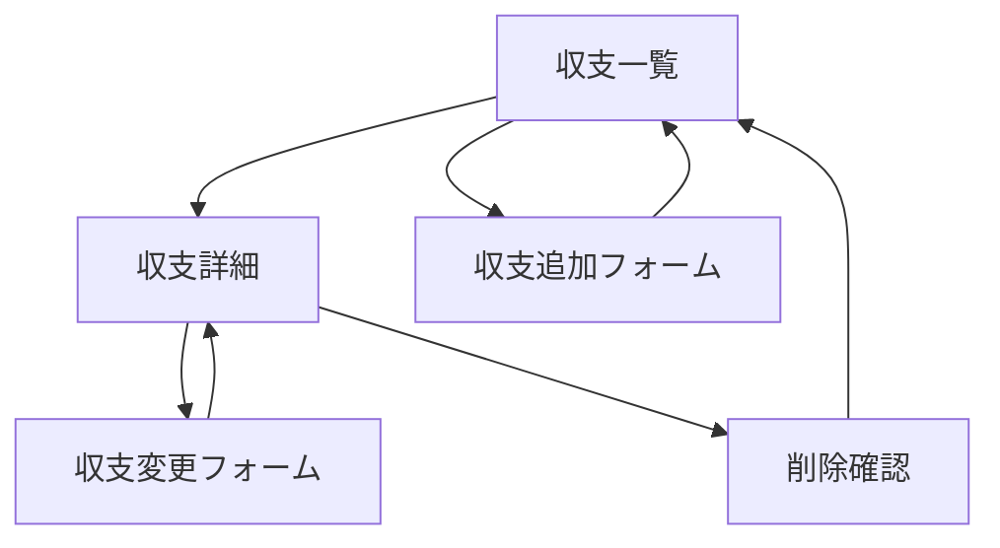
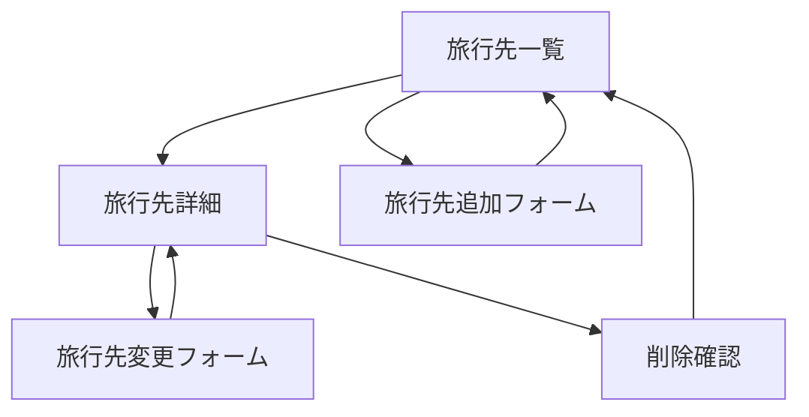
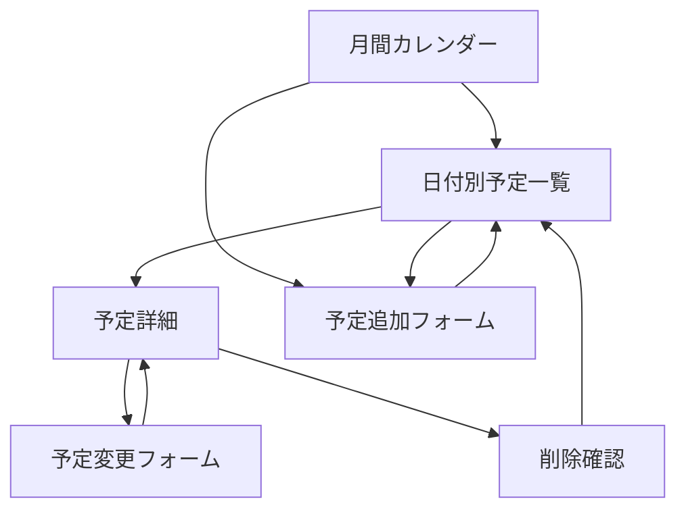

# Webアプリケーション開発計画

## 1. 収支管理システム

### 対象と目的

日々の収入と支出を記録し、現在の残高やカテゴリ別の支出を確認するシステムを開発する。利用者は自分の収支データを追加・確認・変更・削除できる。

### 主な機能

- 収支データの一覧表示
- 収支データの詳細表示
- 収入・支出の追加、変更、削除
- 収入合計、支出合計、残高の表示
- 月別・カテゴリ別の絞り込み

### ページ遷移

### データスキーマ

| 項目名 | 型 | 内容 | 例 |
|---|---|---|---|
| id | Number | データを識別する番号 | 1 |
| type | String | 収入または支出 | 支出 |
| category | String | 収支の分類 | 食費 |
| amount | Number | 金額 | 1200 |
| date | String | 発生日 | 2026-11-13 |
| memo | String | 補足 | 昼食代 |

### 予定するURL

| URL | 内容 |
|---|---|
| `/money` | 収支一覧 |
| `/money/:id` | 収支詳細 |
| `/money/new` | 追加フォーム |
| `/money/:id/edit` | 変更フォーム |

## 2. 旅行先記録システム

### 対象と目的

訪問した場所と今後訪問したい場所を記録するシステムを開発する。旅行先の評価や感想を保存し、地域や訪問状況から記録を確認できるようにする。

### 主な機能

- 旅行先の一覧表示
- 旅行先の詳細表示
- 旅行先の追加、変更、削除
- 訪問済み・未訪問の分類
- 都道府県や評価による絞り込み

### ページ遷移

### データスキーマ

| 項目名 | 型 | 内容 | 例 |
|---|---|---|---|
| id | Number | データを識別する番号 | 1 |
| name | String | 旅行先の名前 | 清水寺 |
| prefecture | String | 都道府県 | 京都府 |
| visitDate | String | 訪問日 | 2026-10-10 |
| status | String | 訪問状況 | 訪問済み |
| rating | Number | 5段階評価 | 5 |
| memo | String | 感想や予定 | 紅葉の時期に再訪したい |

### 予定するURL

| URL | 内容 |
|---|---|
| `/travel` | 旅行先一覧 |
| `/travel/:id` | 旅行先詳細 |
| `/travel/new` | 追加フォーム |
| `/travel/:id/edit` | 変更フォーム |

## 3. 予定確認カレンダー

### 対象と目的

大学の授業、課題、私的な予定を日付ごとに確認するシステムを開発する。月間カレンダーから予定を選択し、詳細の確認や予定の管理を行えるようにする。

### 主な機能

- 月間カレンダーの表示
- 日付別の予定一覧
- 予定の詳細表示
- 予定の追加、変更、削除
- カテゴリによる分類
- 開始時刻と終了時刻の入力確認

### ページ遷移

### データスキーマ

| 項目名 | 型 | 内容 | 例 |
|---|---|---|---|
| id | Number | データを識別する番号 | 1 |
| title | String | 予定名 | Webプログラミング課題 |
| date | String | 予定日 | 2026-11-20 |
| startTime | String | 開始時刻 | 13:00 |
| endTime | String | 終了時刻 | 15:00 |
| category | String | 予定の分類 | 大学 |
| memo | String | 詳細 | 第9回課題を完成させる |

### 予定するURL

| URL | 内容 |
|---|---|
| `/calendar` | 月間カレンダー |
| `/calendar/date/:date` | 日付別予定一覧 |
| `/calendar/events/:id` | 予定詳細 |
| `/calendar/events/new` | 追加フォーム |
| `/calendar/events/:id/edit` | 変更フォーム |

## 共通する実装方針

- ExpressとEJSを使用する。
- データはJavaScriptの配列に保存する。
- 一覧、詳細、追加、変更、削除を実装する。
- 各JavaScriptファイルの先頭に`"use strict";`を記述する。
- 後の授業内容に合わせてREST APIを追加する。
- 利用者向け、管理者向け、開発者向けの仕様を今後追記する。
