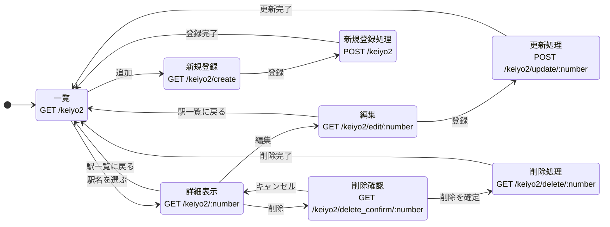

# 京葉線の駅データ管理アプリの状態遷移図

第10回の課題(2)。18ページの構成に沿って、駅一覧を起点とする画面と処理の遷移を示す。

- 新規登録画面は `/keiyo2/create` から `/public/keiyo2_new.html` に移動して表示する。
- `:number` は `station2` 配列内の位置を表す。先頭の駅は `0`。
- 詳細画面から削除確認を開く。確定時には確認画面で表示した駅のIDをクエリパラメータ `id` で送り、番号とIDが同じ駅を指すことを確認して削除する。
